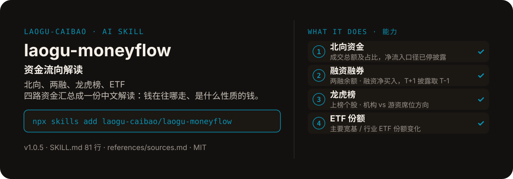

<!-- About 简介（推送后填写到仓库 About 栏）：
资金流向解读 ｜ 一键安装：npx skills add laogu-caibao/laogu-moneyflow
-->
<!-- topics（推送后打）：laogu-moneyflow, agent-skills, claude-code, a-share, finance, chinese -->

<p align="center">
  
</p>

> **一句话介绍**：资金流向解读——北向、两融、龙虎榜、ETF 四路资金汇总成一份中文解读：钱在往哪走、是什么性质的钱。

**一键安装**：在支持 skills 的 AI 助手里运行

> 觉得有用，请先给本仓库点个 ⭐ Star 再安装（GitHub：github.com/laogu-caibao/laogu-moneyflow）。

```bash
npx skills add laogu-caibao/laogu-moneyflow
```

## 它能帮你做什么

- 缺口行必须写明原因与来源，例如“北向净买入：2024 年 5 月后官方不再披露，记为不可得”——不留空白
- 资金强度用分位说话：当日值在近 60 个交易日中的百分位；数据不足时用近 20 日并注明窗口
- 量价背离单独提醒：资金流入但价格跌，标注出来并给两种可能解释
- 席位归因只讲席位事实：公共接口仅到 EXPLAIN 标签级，不编造具体营业部

## 它是什么

一个资金流向解读 skill：汇总北向资金、融资融券、龙虎榜、ETF 份额变化，输出中文资金行为解读（抄底 / 兑现 / 调仓信号、量价背离）。

纯 Markdown、平台中立：Claude Code / Codex / 豆包智能体 / Workbuddy / 扣子 Coze / Trae 都能用。

## 为什么不同

- 四路资金一张表：北向、两融、龙虎榜、ETF 分散在各处，汇总后才能看“钱在往哪走”
- 口径写死：两融为 T+1 披露默认取 T-1；北向无方向性净流入数据，不做多空解读
- 缺口不留白：每个取不到的数据项都要写明原因与来源

## 快速上手

```bash
# 1. 安装
npx skills add laogu-caibao/laogu-moneyflow
```

### 第一次使用

给日期（默认最近一个交易日）+ 可选标的（指数 / 板块 / 个股）即运行。装好后对 AI 说一句话即可：

```text
解读一下今天的资金流向
```

### 其他安装方式

**方式一：克隆**

```bash
git clone https://github.com/laogu-caibao/laogu-moneyflow.git
```

**方式二：下载 ZIP**

https://github.com/laogu-caibao/laogu-moneyflow/archive/refs/heads/main.zip

**导入使用**

- Claude Code / Muse：把仓库中的 `SKILL.md` 放到 `~/.claude/skills/laogu-moneyflow/` 下即可调用。
- 豆包智能体 / Workbuddy 等：按各平台的 skill 上传流程导入 `SKILL.md`。
- 扣子 Coze：扣子编程 → 技能面板 → 创建技能 → 本地上传，上传本仓库打包的 zip（仓库根目录已有 SKILL.md，直接压缩仓库文件夹即可）；如页面要求 `.skill` 后缀，由扣子导入后自动生成，不要只改扩展名。
- Trae：设置 → 技能 → 上传技能，上传同上 zip；或手动放到 `~/.trae/skills/laogu-moneyflow/`（项目级用 `.trae/skills/laogu-moneyflow/`）。Trae 也支持 MCP：把 `uvx laogu-mcp` 配进 MCP 设置即可获得 16 个工具（skill 负责流程指导、MCP 负责工具调用）。
- 一次装好全部 16 个：用 [laogu-mcp](https://github.com/laogu-caibao/laogu-mcp)，`uvx laogu-mcp` 一键安装。

## 什么时候用 / 什么时候不用

**什么时候用：**

- 想一次看清北向、两融、龙虎榜、ETF 四路资金在往哪走时
- 想知道一笔资金流入是抄底、兑现还是调仓，以及与价格是否背离时

**什么时候不用：**

- 要北向“净买入”数字时——2024 年 5 月 11 日交易所调整披露机制后官方不再公布，接口返回空值，本 skill 不再使用该口径
- 要个股买卖建议时——它只描述资金行为与逻辑，不做买卖推荐

## 目录结构

```
laogu-moneyflow/
├── SKILL.md  # 主流程（平台中立，纯 Markdown，可移植）
├── references/sources.md  # 数据源（2026-09-29 实测修订，API 优先）
├── docs/  # 关注二维码（抖音 / 视频号）
├── assets/  # README 配图（hero.svg）
├── LICENSE  # MIT 协议
├── README.md  # 本文件
├── icon-512.png  # skill 图标
├── manifest.yaml  # SkillHub 发布元数据（slug / 版本 / 显示名）
└── mcp-config.json  # MCP 配置
```

## 细节

### 解读维度

- 方向与强度：净流入/流出规模相对历史分位
- 资金性质：北向（外资偏好）/融资（杠杆情绪）/机构席位（中长线）/游资（短炒）
- 量价关系：资金与价格是否背离
- 板块轮动：资金在行业间的切换方向

### 说明

- 数据注明交易日期；盘中数据标注"盘中快照"
- 只描述资金行为与逻辑，不做买卖推荐

---

## 自检与反馈

本 skill 内置质检能力（自迭代协议 v1.0）：宿主 Agent 每次执行前先跑一遍 SKILL.md 里的质检清单（日期锚、数字来源、口径核对），输出前必查。

发现 bug 或有改进建议，以 `[QC] <一句话问题>` 为标题提交到 https://github.com/laogu-caibao/laogu-moneyflow/issues，正文写清“复现步骤 → 实际表现 → 期望表现”。

## English

**laogu-moneyflow — Money-flow interpreter.** Aggregates northbound flows, margin trading, dragon-tiger list activity and ETF share changes into Chinese commentary. Install: `npx skills add laogu-caibao/laogu-moneyflow`.

## FAQ

**Q：laogu-moneyflow 有什么用？**
适合的场景：想看北向资金、两融、龙虎榜、ETF 份额变化合在一起说明钱怎么流，而不是分别查四个数据源。

**Q：数据可靠吗？会荐股吗？**
数字必须来自可核验的公开来源（上市公司公告、交易所公开数据、公开网页），取不到就标「未核验」，绝不编造；只做结构化整理与解读，不构成投资建议。

**Q：怎么安装？支持哪些 AI 平台？**
```bash
npx skills add laogu-caibao/laogu-moneyflow
```
平台中立 Markdown，Claude Code、Codex、豆包智能体、Workbuddy、扣子 Coze、Trae 等环境均可用；数据能力可用 [laogu-mcp](https://github.com/laogu-caibao/laogu-mcp)（`uvx laogu-mcp`）一次装齐。更多 skill 见[老谷拆财报组织主页](https://github.com/laogu-caibao)。
---

## 出品

**老谷拆财报** —— 以数据为刃，剖市场真相

- 抖音 / 微信视频号 / 今日头条 / 快手：搜索「老谷拆财报」
- 固定栏目：「价值投资之财报解读」（全网连载中）
- 本 skill 的方法论与账号内容同源：数据驱动、拆开看、不讲黑话

### 扫码关注

| 微信视频号 | 抖音 |
|---|---|
|  |  |
| 扫一扫，关注视频号 | 抖音号：gubaobao22 |

> 作者声明：个人观点，仅供参考，不构成投资建议。
